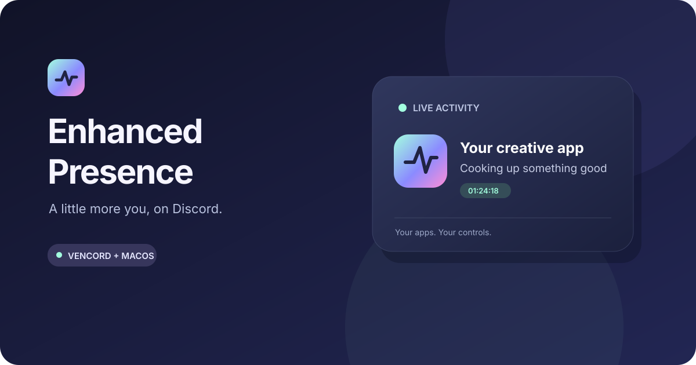

<div align="center">
  

# Enhanced Presence+

Your apps, Apple Music and personal Discord tools.

macOS 13.5+ · Custom Vencord plugin · Unsigned beta · GPL-3.0-or-later


</div>

## Download and install

[**Download the unsigned Plus beta**](https://github.com/Italian-seasoning/EnhancedPresence/releases/tag/v0.10.0-beta.2)

| Your Mac | Download |
| --- | --- |
| Apple Silicon (M-series) | [Apple Silicon installer](https://github.com/Italian-seasoning/EnhancedPresence/releases/download/v0.10.0-beta.2/EnhancedPresence-0.10.0-beta.2-macOS-arm64.dmg) |
| Intel | [Intel installer](https://github.com/Italian-seasoning/EnhancedPresence/releases/download/v0.10.0-beta.2/EnhancedPresence-0.10.0-beta.2-macOS-x64.dmg) |

**This beta is unsigned and unnotarized. macOS may block it.** Only install it if you trust the release. The installer never disables Gatekeeper, removes quarantine, requests an administrator password, or grants privacy permissions. Checksums accompany the downloads.

1. Open the DMG, then **Install Enhanced Presence.app**.
2. Enter a public **Discord Application ID** from the [Developer Portal](https://discord.com/developers/applications), or keep your existing ID when updating. Never enter a bot/account token. Keep Vencord selected for app icons and the best compatibility; task hooks are optional.
3. Choose **Install**, select the stable **Discord.app** in the macOS file picker and confirm **Choose Discord**. This gives setup access to that app; the helper needs no broad privacy permissions. Quit and reopen Discord, then open the menu bar helper's **Settings**, review allowed apps and press **Resume**. Discord's own activity-sharing setting must be on.

Node, Xcode, Git, pnpm and source builds are **not needed** for the downloaded installer. It includes its own runtime and a tested Vencord build. The helper installs into `~/Applications`; settings, pairing and app-time totals stay in `~/Library/Application Support/EnhancedPresence`. First installation starts paused.

The Vencord option replaces the local Vencord build while preserving its settings. Use the source workflow below if you maintain a build with other custom plugins. Discord's newest settings layout can hide Vencord's sidebar even when the plugin works; the helper Settings window controls the same companion settings.

Enhanced Presence is independent of Discord and Vencord. Vencord modifies Discord's client and can violate Discord's terms. Review [Terms of Use](TERMS.md). Vencord does not support third-party plugins; see its [custom-plugin documentation](https://docs.vencord.dev/installing/custom-plugins/).

## What it does

Open **Presence+** beside the Discord message box for the Plus tools:

- Apple Music player with local album artwork and playback controls, independent of public activity sharing.
- Album-derived accents confined to the player.
- Private message bookmarks with notes, tags, search and account-scoped import/export.
- Named workspaces containing channel and DM shortcuts.
- Desktop notification rules with literal keyword/person/channel matching and a grouped inbox.
- Voice controls and a floating native HUD, available from the helper menu's **Show Voice HUD** item.

Each module can be switched off. Existing Vencord settings, other plugin switches and enabled themes remain in place. Plus never selects a theme or restyles Discord's chat surfaces.

Apps can be added from the helper or Vencord settings using **Choose Application…**, then **Add and Allow**. Apple Notes is available as a generic activity; note names and contents are never read. New entries start private until explicitly allowed.

### Optional Messages theme

**Messages for Discord** is a separate compact theme with macOS system typography, blue outgoing bubbles, neutral incoming bubbles and frosted navigation, menus, settings and player surfaces in Discord's existing layout. It supports light/dark colors and Reduce Transparency, and loads no remote CSS, fonts or images.

1. Open **Settings → Vencord → Themes → Open Themes Folder**.
2. Copy **PresenceMessages.theme.css** from the DMG or [release download](https://github.com/Italian-seasoning/EnhancedPresence/releases/download/v0.10.0-beta.2/PresenceMessages.theme.css) into that folder.
3. Turn off other full-client themes, then enable **Messages for Discord**. Turn it off to return to your previous theme. Theme files and options are preserved.

For native macOS glass, set **Vencord → MacOS Window vibrancy style → Sidebar**, then fully quit and reopen Discord. The separate **Enable window transparency** switch is unnecessary for macOS vibrancy and can prevent window resizing. Reduce Transparency uses solid surfaces instead.

Open **Presence+ → Appearance** in a DM to choose a background for that chat. Presets and normalized local photos stay in this Mac’s account-scoped storage and are separate from public presence. They apply only with the Messages or Snapchat theme enabled.

Blue outgoing bubbles use Plus's hidden self-message marker or Vencord's built-in **ThemeAttributes** plugin. The theme can be used without the companion by enabling ThemeAttributes. Installation never changes your theme selection.

With Plus, the composer's **+** menu groups the existing Discord and plugin actions. Turning off Messages restores the original buttons.

### Optional Snapchat theme

**Snapchat for Discord** is a separate theme with a Snapchat-inspired chat look in Discord's existing layout. It uses uppercase sender labels with blue rails for others and red rails for your own messages, Snap Yellow for the selected chat, primary buttons and your reactions, and rounded fields and menus. It supports light/dark colors, Increase Contrast, Reduce Transparency and forced colors, and loads no remote CSS, fonts or images. In one-to-one DMs it shows names instead of repeated avatars.

Install it the same way as Messages: copy **PresenceSnapchat.theme.css** from the DMG or a [release](https://github.com/Italian-seasoning/EnhancedPresence/releases) into the Themes folder, turn off other full-client themes, then enable **Snapchat for Discord**. Per-DM backgrounds and the composer **+** menu work the same way. Red own-message rails use the same self-message marker or **ThemeAttributes**.

The theme is an interpretation, not a copy of Snapchat: it only shows states Discord provides and has no opened, screenshot, replay or disappearing-message indicators.

- Allowed app names, artwork and elapsed time.
- Compact native menu with connection, current activity, Pause and Settings.
- Optional Claude Code/Codex task status such as Editing code, Reviewing code and Running tests. Fixed phrases require no model calls.
- Apple Music song title, artist, album, album cover and available artist portrait; quiet hours, custom text and local app-time totals.
- App activity clears on idle or private apps. Music stays visible while playing; pause, sleep, lock, quiet hours and detector failure clear it.

Choose **Prefer Apple Music** in Settings to keep your track visible in the background.

When playback stops or track metadata is temporarily unavailable, the old song clears immediately. App activity resumes after the configured switch delay; a new playing track takes priority as soon as its metadata arrives.

Vencord supports app names and artwork. Standalone mode avoids modifying Discord and shows text only; Discord may display your Developer Portal application's name there.

## Privacy and efficiency

Core app presence needs **no Accessibility, Screen Recording, Input Monitoring, Automation or Full Disk Access**. Do not grant these permissions to Node, Terminal or your shell for this app.

The local Apple Music player reads metadata and embedded covers on the Mac. Its optional playback buttons use fixed Apple Events addressed to Music and may ask you to allow **EnhancedPresence Helper** to control **Music** in macOS Automation. This grant is only for transport controls; detection, covers and public presence work without it. The helper rejects cancelled or expired control requests.

Project/document names are optional, per app and off by default. Some supported apps need Accessibility for the named EnhancedPresence Helper. If names are unavailable, leave them off; generic presence still works. Settings and pairing remain local. The services use authenticated loopback connections and reject foreign origins. There is no telemetry or account login.

Messages, Mail, Photos, password managers and Discord are always blocked from app tracking. The plugin may fetch public app artwork through Discord; installed local icons are never uploaded. When Apple Music sharing and icons are enabled, a cached Apple catalog lookup uses the shared song title, artist and album to find an exact cover match and a public artist portrait. Album art is the main image; the artist portrait is a small badge whose position Discord controls. No music account, local artwork or library access is required. Unavailable covers fall back to the app icon, and unavailable portraits are omitted. One persistent Node engine runs inside the helper. Vencord repair responds to file changes instead of starting Node on a repeating timer.

### Optional task status

Select **Enable optional task status hooks** in the installer. Hooks record tool categories and a project folder name locally, never prompts, commands or full paths. Project names are hidden from Discord by default; original hook settings are backed up and unrelated hooks are preserved. Codex may require reviewing the added hook in `/hooks`.

AI wording is off by default. Fixed phrases need no CLI/model runs. Opting into AI wording requires your own supported Claude Code/Codex CLI and subscription; availability depends on your account.

## Updating and uninstalling

Download a newer installer and choose **Install**. Existing settings, pairing and local totals are preserved. There is no automatic code updater: Vencord's updater would replace a custom plugin build. Repair can reapply the installed build after Discord updates; a new compatibility fix needs a new Enhanced Presence download. Apple Music relies on a private macOS interface that can change.

To uninstall the companion, reopen **Install Enhanced Presence.app** and choose **Uninstall**. This removes its helper, login services and managed task hooks, while keeping settings, history and Vencord. Use Vencord's official installer if you also want to remove Vencord from Discord.

## Troubleshooting

| Symptom | Check |
| --- | --- |
| macOS blocks the download | This is an unsigned beta, not an Apple-notarized app. Review the release and decide whether to trust it. Do not disable system protections. |
| Waiting for Vencord | Fully quit/reopen Discord, then Resume in helper Settings. Reinstall the bundled plugin if Discord updated. |
| Application name instead of app name | Standalone IPC is active. Use the Vencord option for app names and artwork. |
| No activity | Allow the foreground app, Resume, enable Discord activity sharing, and account for the configured switch delay. |
| No task status | Enable optional hooks, review Codex hook trust, and use an allowed editor/agent app. |
| No album cover or artist portrait | Enable icons in the plugin. Images need an exact Apple catalog match and network access. Unmatched recordings use the app icon; artists without public portraits have no badge. |
| Names unavailable | Keep names off or review the optional helper permission. Never grant Node broad access. |

## Build from source

For development or a Vencord checkout with other custom plugins, install Node.js 22+, Git, Xcode command-line tools and CMake:

```sh
git clone https://github.com/Italian-seasoning/EnhancedPresence.git
cd EnhancedPresence
npm run quickstart -- --application-id YOUR_APPLICATION_ID
```

Add `--with-hooks` to opt into task hooks, `--standalone` to skip Vencord, or `--vencord /absolute/path/to/Vencord` to use your own checkout. Source setup downloads the exact pnpm version required by the tested Vencord revision. Run `npm run doctor` for live connection and resource checks.

`npm test` covers protocol, privacy, settings, recovery, installer and packaging logic. Real-machine checks: `ENHANCED_PRESENCE_NATIVE_SMOKE=1 npm test` (input clock) and `ENHANCED_PRESENCE_PERF=1 npm test` (resource limits).

To package a developer-built Vencord checkout containing the plugin:

```sh
npm run package:macos -- --arch arm64 --vencord /absolute/path/to/Vencord
npm run package:macos -- --arch x64 --vencord /absolute/path/to/Vencord
```

The release workflow builds both downloads from a version tag and verifies checksums before publishing. Bundled dependencies retain their licenses and corresponding-source links. Report vulnerabilities privately via [SECURITY.md](SECURITY.md).
